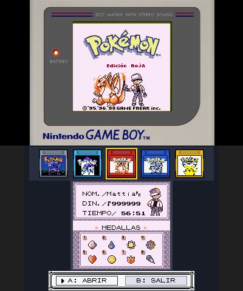
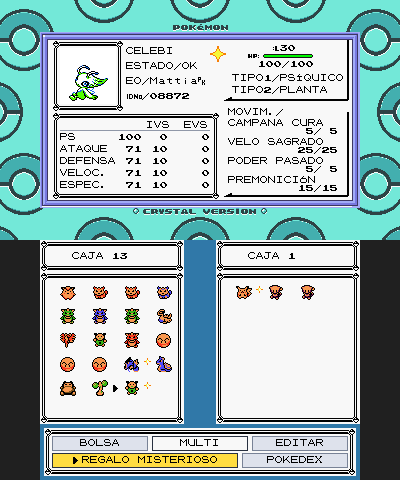
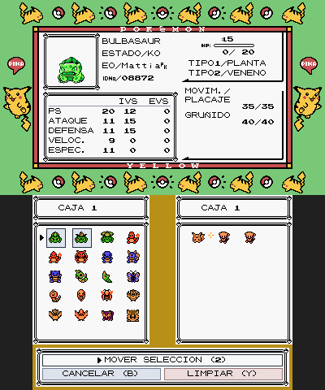
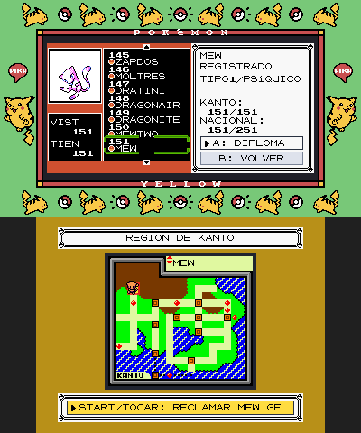
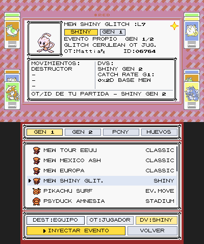
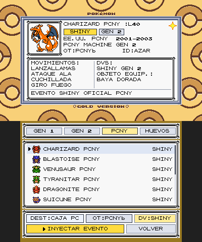
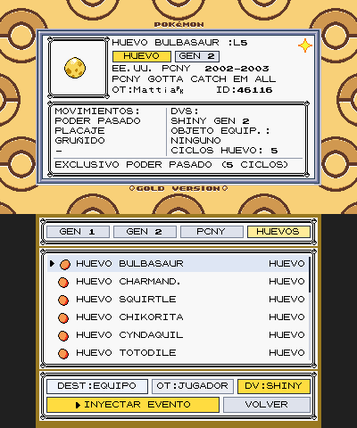
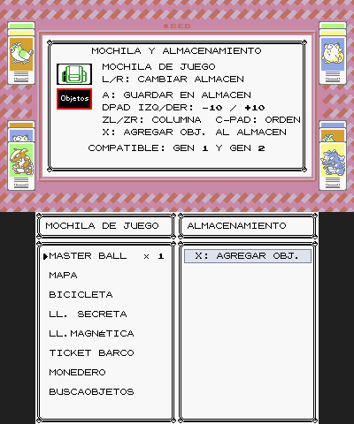

# PKBankVC (Pokémon Bank for Virtual Console)
[](https://www.nintendo.com/3ds/)
[]()
[](LICENSE)
[]()

**PKBankVC** is an all-in-one, homebrew Pokémon Bank, Event Distributor, and Save Manager built specifically for the Game Boy (Gen I) and Game Boy Color (Gen II) Virtual Console titles on the Nintendo 3DS family of systems.

Featuring a dedicated 100-box storage cloud (up to 3,200 Pokémon), a **105-event Historical Mystery Gift injector** (Gen I, Gen II, PCNY Shinies/Odds, and PCNY Eggs), a per-game Game Freak Mew reward, an authentic animated Pokédex, full Bag & PC Item storage, and a touch-screen Pokémon Editor with save anti-corruption safeguards verified against `PKHeX`.

---

## 📸 Screenshots

<table align="center">
  <tr>
    <td align="center"><br/><sub><b>Title Selector &amp; Trainer Card</b></sub></td>
    <td align="center"><br/><sub><b>100-Box Bank &amp; Crystal UI</b></sub></td>
    <td align="center"><br/><sub><b>Batch Multi-Move (MULTI)</b></sub></td>
    <td align="center"><br/><sub><b>Pokédex, Habitat Map &amp; GF Mew</b></sub></td>
  </tr>
  <tr>
    <td align="center"><br/><sub><b>Mystery Gifts: Gen I &amp; Mew</b></sub></td>
    <td align="center"><br/><sub><b>Mystery Gifts: PCNY Shinies</b></sub></td>
    <td align="center"><br/><sub><b>Mystery Gifts: Shiny Eggs</b></sub></td>
    <td align="center"><br/><sub><b>Multi-Gen Bag &amp; Item Storage</b></sub></td>
  </tr>
</table>

---

## 🌟 Key Features

### 🏦 100-Box Bank Storage (3,200 Pokémon)
- Store up to **3,200 Pokémon** across 100 secure boxes saved directly to `/pk/bank/bankgb.bin` on your SD card.
- Seamlessly transfer Pokémon between Gen I and Gen II games with automatic validation, type/stat conversion, and **strict Gen I & Bank anti-corruption safeguards** (blocking Eggs from entering the Bank and blocking Gen II species, held items, or Gen II moves from entering Gen I saves).
- Clean separated top-screen portrait & stats panels with green HP bars, full support for Gen II Eggs (authentic Crystal Egg sprite), shininess, original trainer IDs, nicknames, and accurate species-growth EXP curves.

### 🎮 Comprehensive Virtual Console Compatibility
Supports all 7 main-line Game Boy and Game Boy Color releases across every language and region:
- **Generation I:** Pokémon Red, Green, Blue, and Yellow (EN / ES / FR / DE / IT / JP).
- **Generation II:** Pokémon Gold, Silver, and Crystal (EN / ES / FR / DE / IT / JP).
- Automatic save discovery via Virtual Console title detection (`Title Selector`) with live trainer preview card.
- Automatic SRAM bank detection and checksum re-calculation (including Crystal backup mirrored checksums).

### 📖 Authentic Pokédex & Habitat Map
- Authentic Pokémon Crystal UI with full 56x56 animated Crystal front sprites.
- **Dynamic Discovery Mode:** Pokémon remain as `?????` (Unknown) until deposited into the Bank.
- **Interactive World Map:** Visual habitat tracker for Kanto and Johto with flashing species indicators and route names.
- **Official Diploma Verification:** Celadon Game Freak Diplomas (150 Kanto / 250 Johto) verified directly against your active game save data.

### 🎒 Multi-Generation Bag & PC Item Storage
- Dedicated 100-slot Bank Item Storage for holding items, TMs, HMs, and Key Items.
- Smart item conversion between Gen I and Gen II item IDs, including corrected Gen II Item/TM/HM ID tables (`149..255`).
- Automatic security locks preventing Gen II items or held items from entering Gen I games.

### ✨ Built-in Touch Pokémon Editor & Move Manager
Press **START** (or tap **EDITAR**) on any Pokémon to access the unified touch editor:
- **Instant Shiny Converter:** Automatically generates valid Gen II shiny IV spreads ($10/10/10/10$).
- **DV / IV & EV Customizer:** Full manual control over Attack, Defense, Speed, and Special stats.
- **Level, EXP & Safe Egg Hatching:** Adjust levels using exact per-species growth rates, or safely hatch Eggs to Level 5 (resetting nickname, friendship `120`, and Pokédex registration).
- **Simulated Trade Evolutions:** Evolve trade-evolution Pokémon directly inside the Bank/Cartridge (Kadabra $\rightarrow$ Alakazam, Machoke $\rightarrow$ Machamp, Graveler $\rightarrow$ Golem, Haunter $\rightarrow$ Gengar, plus Gen II held-item trade evolutions including Kingdra via Dragon Scale and Porygon2 via Up-Grade) without requiring a second 3DS console.
- **Move Manager (Tab 2):** Modify moves with generation legality rules (`1..165` in Gen I, `1..251` in Gen II/Bank), automatic move-slot compaction, duplicate/empty-moveset protection, and automatic base PP calculation.
- **Touch-and-Hold Quick Clone:** Hold any Pokémon on the bottom screen for 2.5 seconds to clone and place it anywhere in your boxes.

### 🎀 Historical Mystery Gifts (105 Events)
Access the **REGALO MISTERIOSO** menu from the 2-row bottom toolbar to distribute **105 historically accurate Gen I & Gen II events**:
- **4 Categories:** **GEN 1** (`15` events, including `MEW TOUR EEUU`, `MEW MEXICO ASH`, `PIKACHU SURF` / `PIKACHU STADIUM`, `PSYDUCK AMNESIA`, Stadium prizes, and custom `MEW SHINY GLITCH` with Player OT/TID), **GEN 2** (`5` events, including `PKHeX`-legal Crystal VC GS Ball `CELEBI ENCINAR VC`, `CELEBI TOUR EU/US`, and *Stadium 2* rewards), **PCNY** (`19` *Pokémon Center New York* distributions `PCNYa–d`, including Legendary Birds, Mewtwo, Johto/Kanto starters, Legendary Beasts/Tower duo, plus `MEW PCNY` `0.5%` and `CELEBI PCNY` `1.0%` using `ODDS_SHINY_GEN2`), and **HUEVOS** (`66` PCNY Strange Egg variants with `5` hatch cycles).
- **Flexible Delivery & Options:** Inject directly into the first free **PC Box** (`CAJA PC`), active **Party** (`EQUIPO`), or **Bank** (`BANCO`); cycle official **OT** presets; jump lists quickly with **ZL / ZR**; and toggle **`DV: AZAR / PROB / SHINY`** on random or odds-based events.

### 🎁 Mystery Gift: GF Mew (UK 2016)
- Register the original 150 Kanto Pokémon (`#1` to `#150`) in your **active save's Pokédex** to unlock a **1× per-game** reward.
- Claim the canonical Game Freak UK 2016 Mew (`OT: GF`, `TID: 22796`, Max DVs `15/15/15/15`, Level 5, Pound, no item) directly from the Pokédex screen — safely placed in the first empty Bank slot without overwriting existing Pokémon.

### 📦 Multi-Pokémon Batch Movement
- Switch into **MULTI** selection mode from the clean 2-row bottom toolbar (`BOLSA` | `MULTI` | `EDITAR` / `REGALO MISTERIOSO` | `POKEDEX`).
- Select multiple Pokémon simultaneously with stylus or A button and move them across boxes in a single transfer with capacity, Egg-in-Bank, and Gen I legality verification.

---

## 🕹️ Controls

| Button | Action |
| :--- | :--- |
| **D-Pad / Circle Pad** | Navigate boxes and Pokémon slots |
| **A** | Select / Pick up Pokémon / Open Diploma (in Dex) |
| **B** | Cancel selection / Go back |
| **X** | Open Bag & Item Storage |
| **Y** | Open Bank Pokédex & Habitat Map |
| **START** | Open Pokémon Editor / Save & Exit Editor |
| **SELECT** | Return to Title Selector |
| **L / R** | Switch active box (Previous / Next) |
| **Stylus / Touch** | Direct slot selection, box switching, touch-and-hold cloning & 2-row bottom toolbar (`BOLSA`, `MULTI`, `EDITAR`, `REGALO MISTERIOSO`, `POKEDEX`) |

---

## 📦 Installation

### Method 1: CIA Installation (Recommended for Home Menu)
1. Copy `PKBankVC.cia` to your SD card (e.g., `/cias/`).
2. Open **FBI** on your 3DS.
3. Navigate to `SD` $\rightarrow$ `cias` $\rightarrow$ `PKBankVC.cia` and select **Install and delete CIA**.
4. Launch **PKBankVC** directly from your 3DS Home Menu.

### Method 2: Homebrew Launcher (.3DSX)
1. Copy `PKBankVC.3dsx` and `PKBankVC.smdh` to `sdmc:/3ds/PKBankVC/`.
2. Open **Homebrew Launcher** and launch **PKBankVC**.

---

## 🛠️ Building from Source

### Prerequisites
- [devkitPro](https://devkitpro.org/) with `devkitARM`.
- 3DS libraries: `libctru`, `citro2d`, `citro3d`, `tex3ds`.
- Python 3 (for build scripts).

### Compile
```bash
git clone https://github.com/lux0s1/PKBankVC.git
cd PKBankVC
make
make cia
```
The compiled binaries (`PKBankVC.3dsx`, `PKBankVC.smdh`, and `PKBankVC.cia`) will be generated in the root directory.

---

## 👥 Credits & Acknowledgments
- **SilverDemon** — Project Lead, Main Developer, modern architecture, Pokédex, touch editor, item storage, and bug fixes.
- **Antigravity (Google DeepMind)** — Autonomous AI software engineering agent: codebase audit, UI/touch system redesign, animated Pokédex integration, SRAM & save memory bug fixes, and custom pixel-art asset design.
- **Gocario** — Creator of the original PHBankGB base project.
- **devkitPro & libctru contributors** — 3DS homebrew toolchain, citro2d, and graphics libraries.
- **Game Freak & Nintendo** — Pokémon series and Virtual Console releases.

---

## ⚖️ Disclaimer
*Pokémon is a registered trademark of Nintendo, Game Freak, and Creatures Inc. PKBankVC is a non-profit, fan-made open-source tool not affiliated with or endorsed by Nintendo or The Pokémon Company.*
